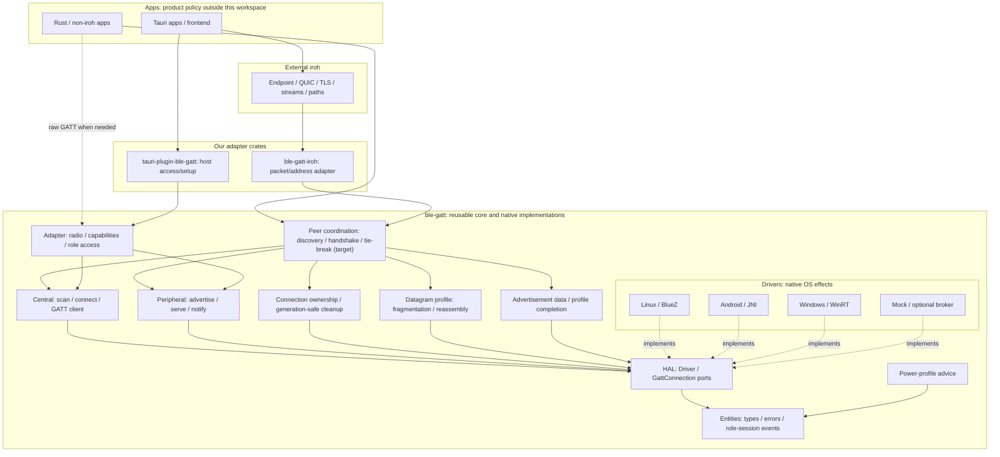

# Architecture: crates, roles and ownership

The shared target design is [ADR-0012](adr/0012-discovery-like-nearby.md).
[ADR-0011](adr/0011-windows-winrt-driver.md) owns Windows-native choices.
The nonce handshake and core/iroh migration are not implemented.
Current API examples do not define target signatures.

## Workspace boundaries

- [`ble-gatt`](../ble-gatt/README.md): generic GATT operations, complete messages,
  core peer coordination, resource ownership and native/mock drivers.
- [`ble-gatt-iroh`](../ble-gatt-iroh/README.md): custom packet/address adaptation,
  authenticated iroh key mapping and accounting of iroh users of a BLE carrier.
- [`tauri-plugin-ble-gatt`](../tauri-plugin-ble-gatt/README.md): host access,
  permissions, lazy construction and Android bridge/context setup.
- **External iroh:** authenticated QUIC connections, encryption, streams and paths.
- **Applications:** eligibility, product pairing, acceptance and application data.

The core works without iroh or Tauri. A Tauri app can obtain a shared core
`Adapter` from the plugin while using the Rust data path directly; packet traffic
need not cross frontend IPC. Android still needs a compatible native bridge and
Application context, even in a non-Tauri host.

## Target map

Boxes group responsibilities; arrows show selected caller/provider dependencies,
not every call. `Peer coordination` does not name an approved class or new crate.



Drivers keep native objects/callbacks and session-scoped effects behind the
ports. Core policy does not replace their ownership guards or serialization.
Power profiles provide advice rather than mandatory radio control.

## Roles and lifecycle

A central initiates a BLE connection; a peripheral serves GATT. Writes in one
direction and notifications in the other already provide bidirectional traffic.
Either eligible application peer can initiate the target protocol. A permanent
identity-ranked dialler and caller-selected initiation modes are not the target.
Raw role operations remain available for vendor devices without our handshake.

```text
advertise / discover -> peer information -> request connection
    -> acceptance on both sides -> messages -> disconnected
```

Metadata completion is an internal discovery procedure, not an accepted message
connection. Stopping discovery or advertising must preserve active communication
and the native resources it needs. Finishing a message does not release a healthy
connection. Explicit disconnect/cancel must not be undone by an independent loop.

The new core tie-break compares per-attempt nonces for the same endpoint. The
larger wins; equal nonces fail both. The losing outgoing request reports failure;
the winning incoming request is processed separately. Do not transfer its success
to the outgoing caller. Closing a loser is not global peer disconnection.
Endpoint correlation, native session generation and authenticated identity are
different facts. See ADR-0012 for source references and remaining wire/API gates.

## Current implementation gap

Today the iroh path is:

```text
Application -> external iroh -> BleGattTransport
            -> datagram::connect / serve -> HAL -> native driver
```

The adapter still owns initiation modes and crossed-candidate handling. It
accounts for current iroh path use separately from historical address mappings.
Core `PeerLink::Symmetric` still selects a lower-`LinkId` dialler; it is not the
new protocol or a mandated basis for it. Do not nest independent native
retry/close owners to simulate the target.

Existing core metadata completion is opt-in. Its timer-based refresh is not
Nearby's exact wire protocol. The datagram server still admits one inbound peer;
this design does not establish Cluster/M-to-N or universal crossed-dial support.

Reuse state tables, owned handles, fragmentation/reassembly and native guards
where their contracts fit. Implement peer behavior without integrations, then
adapt iroh. See [current API examples](interface.md).

## Layers and validation

The layer vocabulary remains that of [ADR-0007](adr/0007-layered-architecture.md):

- **Entities:** reusable data and pure rules; no I/O.
- **Use Cases:** `hal`, `roles`, `connection`, `profile` and `power`.
- **Interface Adapters:** the iroh and Tauri crates.
- **Frameworks & Drivers:** native and mock implementations of the ports.

### How the layers map onto OSI

OSI is an explanatory protocol analogy, not a crate or ownership rule. The
Bluetooth radio/OS stack supplies physical/link mechanisms; the GATT profile
adds complete messages. In the iroh composition, QUIC supplies transport streams
and security above that carrier, and the application supplies its data protocol.
Tauri setup and power advice are not packet layers. A type named `DataLink`
does not establish its actual protocol layer.

Follow [ADR-0012's migration gates](adr/0012-discovery-like-nearby.md#migration-and-verification-gates-for-this-pr).
Mock checks, JNI bytecode/packaging checks, observed native sessions and physical
OS teardown are separate evidence levels. Old candidate-model results do not
certify the new handshake. Procedures and limits live in
[hardware-verification.md](hardware-verification.md).
