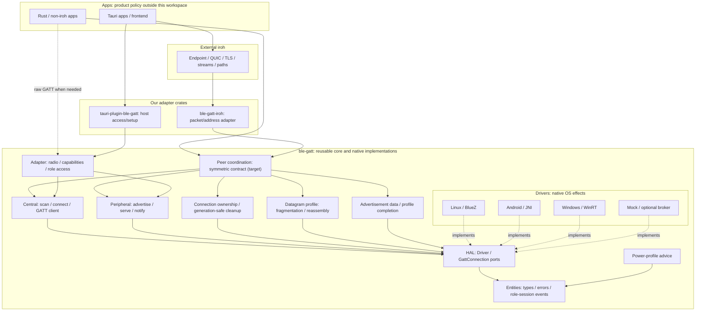

# Architecture: crates, roles and ownership

This is the workspace responsibility map. It separates the **current source**
from the **provisionally agreed target** in
[ADR-0014](adr/0014-core-peer-ownership.md). The documentation does not claim
that the target refactor or its hardware acceptance is complete.

## Read one document per crate

- [`ble-gatt`](../ble-gatt/README.md): reusable BLE operations, message profile,
  native ownership and the target symmetric peer behavior.
- [`ble-gatt-iroh`](../ble-gatt-iroh/README.md): iroh packet/address adaptation
  and accounting of iroh users of a BLE carrier.
- [`tauri-plugin-ble-gatt`](../tauri-plugin-ble-gatt/README.md): Tauri access,
  permissions, lazy driver construction and Android bridge/context setup.

Iroh is an **external library**, not a fourth workspace crate. Applications
such as Fini are consumers, not another layer implemented by the core.

## Provisional target

An application can use `ble-gatt` directly. An application using iroh adds the
iroh adapter above the same core. A Tauri application obtains access and host
initialization through the Tauri adapter; its data need not cross frontend IPC.

**Symmetric initiation is the peer-to-peer contract, not an optional mode.**
Either eligible peer can initiate or reconnect. One established BLE connection
carries messages both ways. The core coordinates competing physical attempts
and reports platform limits; applications do not choose a permanent initiator
or select between `PreviousDialer`, `EitherPeer` and `Ordered`.

The following graph has 19 component nodes. Boxes group responsibilities;
arrows show selected caller/provider relationships, not a packet timeline or
an exhaustive Rust import graph. `Peer coordination` is a target responsibility,
not the name of a new type or an implemented API.



The driver-to-HAL arrows mean implementation dependencies, not commands from
hardware into the API. Native callbacks/events return through the same ports.
Power profiles provide advice, not mandatory radio control. The exact discovery
schedule and peer-request lifetime remain open; the graph does not decide them.

## Responsibility boundaries

### Apps

Choose permitted peers, product pairing, communication intent, sync settings,
application protocols and user-facing session acceptance. Product eligibility
is not something a generic BLE driver can decide. Core connection recovery
must not depend on each application implementing its own BLE controller.

### External iroh

Owns authenticated QUIC connections, encryption, streams and path selection.
A cryptographic peer key identifies who is communicating; a current transport
address says where packets can be sent. Iroh does not define our BLE role
policy or native cleanup mechanism.

### iroh adapter

Converts iroh packets and addresses to core messages/destinations. Observes
which iroh users need a carrier and releases its use when they finish. Current
versus historical QUIC paths remain different facts. None of this should put
native Bluetooth coordination or iroh types into the wrong crate.

Iroh's custom-transport interface is explicitly unstable. Dependency upgrades
can require changes in this adapter. That is a reason to isolate the coupling,
not evidence that the BLE carrier or encryption is inherently unreliable.

### Tauri adapter

Supplies application access and platform initialization. It is not a second
network stack. The Rust API returns a shared core `Adapter`; JavaScript uses
commands and IPC events. Android registration supplies Application context and
packages the Kotlin bridge. Tauri-specific permission dialogs stay here.

### Central and peripheral

Central initiates a BLE connection and uses GATT client operations. Peripheral
accepts the connection and serves GATT data. These are connection roles, not
permanent identities of applications. Central writes and peripheral
notifications allow traffic in both directions over one connection.

Raw role APIs remain useful for vendor protocols. Symmetric app peers are a
higher-level core use case, not a requirement imposed on a lamp or sensor.

### Core ownership and drivers

Core connection policy coordinates admission, recovery, competing attempts and
resource use. Drivers implement the HAL and own platform objects, callbacks,
operation serialization and session-aware native effects. A shared helper must
not separate an ownership check from the action it protects.

The profile owns message boundaries, fragment encoding/reassembly and
advertisement completion. It does not authenticate an application. Discovery
metadata can select a candidate; it does not prove its identity.

## Current implementation and required transition

The existing iroh path is:

```text
Application -> external iroh -> BleGattTransport
            -> datagram::connect / serve -> HAL -> platform driver
```

Tauri supplies the shared adapter and Android host setup alongside this path.
The current adapter owns candidate queues, hook-learned key/address mappings,
last-user release and `InitiationPolicy`. Its default is `PreviousDialer`.
`EitherPeer` is explicit; `Ordered` is another current option
([ADR-0013](adr/0013-symmetric-iroh-initiation.md)).

The core already has an owned `Connection`, pure connection-state tables and
`PeerLink`. However, `PeerLink::LinkRole::Symmetric` uses a lower-`LinkId`
dialler. Its acceptance, retry and channel contracts differ from the iroh
adapter. Simply putting that controller under the existing adapter would
create conflicting owners and would not implement the agreed target.

The next design must reuse or revise those core mechanisms and let the adapter
consume the result. Remove the public initiation choice only with its actual
replacement and tests. This documentation change does not remove an API.

Native Kotlin currently ships under the Tauri plugin while its Rust/JNI driver
is in the core. A non-Tauri Android host still needs compatible bridge/context
packaging. Whether to change that packaging is open, not an approved new crate.

## Implemented core module map

```text
ble-gatt/src/
  entities/          Models and errors
  hal/               Driver and GattConnection ports
  roles/
    adapter.rs       Radio, capabilities and role access
    central.rs       Scan and owned outgoing GATT connection
    peripheral.rs    Serving, notifications and ServerHandle
  connection/
    handle.rs        Owned Connection and lifecycle observation
    link_state.rs    Pure state transitions
    peer_link.rs     Existing tracked-peer worker
  profile/
    advertisement.rs  GATT metadata and scan completion
    datagram/         Complete-message channel, fragments and reassembly
  power/             Power-profile advice
  drivers/
    linux.rs         BlueZ
    android.rs       Rust/JNI
    windows/         WinRT device, peripheral, watcher and byte helpers
    mock/            Local/remote mock radio and broker
```

This is the actual layout, not the older proposed `backend/` migration tree.
There is no implemented `roles/advertiser.rs` or Apple driver in this snapshot.
The peripheral role includes advertising operations.

## Layers and dependency direction

The layer vocabulary follows
[Clean Architecture](https://blog.cleancoder.com/uncle-bob/2012/08/13/the-clean-architecture.html)
and [ADR-0007](adr/0007-layered-architecture.md):

- **Entities:** reusable data and pure rules; no I/O.
- **Use Cases:** `hal`, `roles`, `connection`, `profile` and `power`.
- **Interface Adapters:** the iroh and Tauri crates.
- **Frameworks & Drivers:** native and mock implementations of the ports.

External SDK/framework types stay behind their interfaces. Core code must not
need iroh or Tauri in order to provide the agreed peer behavior. The driver
factory is a convenience; injected drivers remain the test boundary.

## How the layers map onto OSI

OSI terms are explanatory protocol analogies, not ownership or crate rules.
`L` followed by a number refers to OSI, not the software layers above.

- Bluetooth radio and the OS stack provide the physical/link mechanisms.
- The GATT profile adds complete messages above characteristic operations.
- In the iroh composition, QUIC provides reliable streams, authentication and
  encryption above the chosen packet carrier.
- The application defines its session and data protocol.
- Power advice and Tauri initialization are not protocol layers.

An application type named `DataLink` does not establish its actual protocol
layer. Trace composition and ownership instead of inferring them from its name.

## Lifetimes, events and verification

Owned handles expose state/events and keep native work tied to the correct
connection generation. Explicit async shutdown and best-effort cleanup on Drop
are not equivalent. In particular, a datagram serve-stream Drop does not stop
the service; see the [core README](../ble-gatt/README.md).

Report event loss rather than silently treating stale observations as current.
Keep a native GATT session identifier distinct from a QUIC connection and an
application session. An empty adapter map does not prove that all candidate
tasks or native resources have ended.

Keep diagnostics in example/test support. Builds, mock tests, packaged JNI
execution, native-role/session observations and physical OS teardown are
separate validation levels. No target diagram is evidence of those results.
See [hardware verification](hardware-verification.md) and
[ADR-0014's acceptance requirements](adr/0014-core-peer-ownership.md#migration-and-acceptance-requirements).

## Still open before implementation

Peer-request lifetime, retry budget, discovery/advertising scheduling, the
exact shared ownership API, platform collision handling and Android packaging
are listed in [ADR-0014](adr/0014-core-peer-ownership.md#open-design-questions).
They must be resolved before turning the target into a source refactor.
